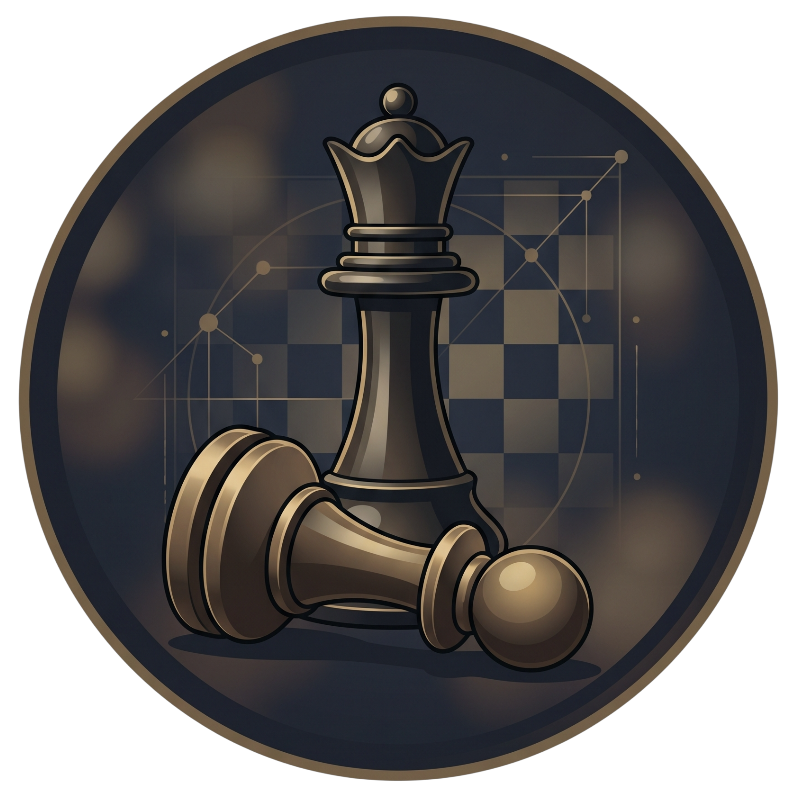

# ChessSense HUD

<p align="center">
  
</p>

<p align="center">
  <strong>Hardware-accelerated live chess telemetry, Stockfish 17 NNUE tactical radar, and undetectable stealth companion for Chess.com & Lichess.</strong>
</p>

<p align="center">
  <a href="#how-it-works">How It Works</a> •
  <a href="#core-features">Features</a> •
  <a href="#supported-browsers">Browser Support</a> •
  <a href="#getting-started">Getting Started</a> •
  <a href="#keyboard-shortcuts">Shortcuts</a> •
  <a href="#support">Support</a>
</p>

---

## Overview

**ChessSense** is an elite desktop tactical companion engineered for real-time board analysis, Grandmaster training, and stealth live assistance. By pairing a high-frequency browser connector with a hardware-accelerated desktop HUD, ChessSense delivers deep evaluation insights, multi-move candidate trajectories, and pre-game opponent scouting directly to your screen with zero browser lag.

Built from the ground up for **streamers, competitive analysts, and stealth operators**, ChessSense operates invisibly during Discord screen-shares and OBS recordings while humanizing every move to ensure complete platform safety.

---

## How It Works

```text
┌──────────────────────────────────────────────┐        ┌────────────────────────────────────────┐
│  Any Browser: Chrome / Edge / Opera / Firefox │        │           ChessSense Desktop           │
│  ┌────────────────────────────────────────┐  │        │             Tactical HUD               │
│  │        Chess.com / Lichess.org         │  │        │  ┌──────────────────────────────────┐  │
│  │    [Zero-Lag Live Board Observer]      │  │        │  │     Interactive 2D Board &       │  │
│  └───────────────────┬────────────────────┘  │        │  │      Evaluation Telemetry        │  │
│                      │                       │        │  └──────────────────┬───────────────┘  │
│                      ▼                       │        │                     ▼                  │
│       ChessSense Browser Connector           ├───────►│          Stockfish 17 NNUE             │
│       • Live Board & Clock Telemetry         │ Instant│          • Max 99 Depth & Multi-PV     │
│       • Optional On-Board Overlays           │ Sync   │          • Blunder Shield Traps        │
│       • Full Stream-Proof Concealment        │◄───────┤          • Humanized Delay Advisor     │
└──────────────────────────────────────────────┘        └────────────────────────────────────────┘
```

1. **Live Synchronization**: The ChessSense browser connector reads the active board position and clock time directly from Chess.com or Lichess with sub-millisecond latency.
2. **Local Calculation**: The desktop HUD evaluates candidate moves using the world's strongest chess engine (**Stockfish 17 NNUE**), running completely locally on your hardware.
3. **Adaptive Visuals**: Top tactical choices, candidate arrows, threats, and human tempo delay advisories appear in real-time on your HUD or on-board overlay.

---

## Core Features

### ⚡ 1. Stockfish 17 NNUE Engine Core
* **Max 99 Depth & Multi-PV**: Evaluates up to 3 simultaneous lines with custom CPU thread allocation.
* **Ranked Candidate Trajectories**:
  * **Rank #1 (Best Move)**: Solid emerald vector showing the optimal tactical continuation.
  * **Rank #2 (Alternative Line)**: Cyan arrow highlighting strong positional alternatives.
  * **Rank #3 (Dynamic Choice)**: Amber arrow for tactical sharpness and dynamic complications.
* **Opponent Ponder Predictor**: Anticipates the opponent's most likely response with ghosted indicators before they play.
* **Syzygy 7-Piece Endgame Tablebases**: Instant mathematical endgame solutions (Win / Draw / Loss verification).

### 🛡️ 2. Stream-Proof Radar (OBS & Discord Invisible)
* **Hardware-Level Capture Bypass**: Utilizes native OS display flags to completely exclude the ChessSense HUD from:
  * **Discord Screen Share & Streams**
  * **OBS Studio & Streamlabs (Window & Display Capture)**
  * **Twitch, Kick, and YouTube streaming software**
  * **Standard Screen Recording & Screenshot utilities**
* **Clean Screen Guarantee**: You see the full HUD and arrows on your monitor; your stream and viewers see only a normal, clean chessboard.

### ⏱️ 3. Humanized Stealth & Anti-Cheat Camouflage
* **Move Delay Advisor (Smart Tempo Meter)**:
  * Calculates believable human move times based on game phase, position complexity, and remaining clock.
  * Displays a live countdown bar (*"Wait 2.8s — Safe Human Tempo"*) to eliminate robotic move clustering.
  * Selectable profiles: *Bullet / Fast Blitz*, *Realistic Blitz (0.8s - 2.5s)*, *Standard Rapid (2.0s - 5.5s)*, and *Classical (4.0s - 9.0s)*.
* **Smart Softening Mode**:
  * Deliberately avoids inhuman micro-tactics when a natural Master alternative exists within a safe centipawn margin.
  * Maintains a believable **92–95% accuracy** profile instead of suspicious 99.8% computer perfection.
* **Flag Protection Auto-Throttle**:
  * Reads live clock times; scales down calculation times automatically when under 45 seconds, and transitions to ultra-fast bullet mode under 15 seconds to prevent flagging.

### 🎯 4. Pre-Game Opponent Scouting (Intel Engine)
* **Instant Match Detection**: Automatically identifies your opponent's username the moment a game starts.
* **Tilt Detection Meter**: Flags opponents currently on losing streaks who are prone to impulsive sacrifices or time collapses.
* **3-Point Tactical Directives**:
  * *Repertoire Weakness*: Identifies specific opening lines where the opponent's historical win rate collapses under 35%.
  * *Pawn Structure Advice*: Advises whether to trade queens into endgames or keep the board sharp.
  * *Time-Trouble Exploit*: Highlights how fast the opponent moves under pressure.

### ⚠️ 5. Tactical Threat & Blunder Trap Radar
* **Hanging Piece & Skewer Warnings**: Color-coded tactical warnings for undefended pieces, pinned pieces, and discovered attacks.
* **Poisoned Piece & Greed Move Detector**: Alerts you when an opponent piece appears free to capture but is actually a dangerous tactical trap.

### 🎨 6. Obsidian Gold Design & Usability
* **Obsidian Gold Palette**: Sleek dark luxury aesthetic with warm antique bronze borders and gold accents.
* **Theme System**: Choose from *Obsidian Gold*, *Midnight Dark*, *Nord Frost*, *Cyber Neon*, *Dracula*, and *Clean Light*.
* **Compact Navigation**: Icon-only navigation mode for minimum horizontal footprint.
* **Solo Board Mode (`Alt + B` / `F2`)**: Instantly collapses the window down to only the 2D chessboard replica.
* **Emergency Panic Mode (`Alt + H` / `Ctrl + Shift + X`)**: Instantly clears all visual overlays, arrows, and evaluations in 0 ms.
* **Eyes-Free Voice Announcer**: Discreetly speaks top moves aloud using Windows Text-to-Speech.

---

## Supported Browsers

ChessSense supports all major web browsers across both Chromium and Gecko engines:

| Browser | Status | Setup Method |
| :--- | :---: | :--- |
| **Google Chrome** | Supported | `chrome://extensions/` ➔ Load unpacked |
| **Brave Browser** | Supported | `chrome://extensions/` ➔ Load unpacked |
| **Microsoft Edge** | Supported | `edge://extensions/` ➔ Load unpacked |
| **Opera & Opera GX** | Supported | `opera://extensions/` ➔ Load unpacked |
| **Mozilla Firefox** | Supported | `about:debugging` ➔ Load Temporary Add-on |

---

## Getting Started

### 1. Run the Installer
1. Download and run `ChessSense_Setup.exe`.
2. Follow the setup wizard to complete the installation.
3. Launch **ChessSense HUD** from your desktop or Start Menu.

### 2. Activate Your License Key
1. Enter your private license key (`CS-XXXX-XXXX-XXXX`) in the activation prompt.
2. The HUD will instantly verify your pass and unlock all pro capabilities.

### 3. Add the Browser Connector
Open the **Browser Extension Folder** (accessible directly from your Start Menu under *ChessSense HUD*):

* **Chrome / Brave**: Open `chrome://extensions/` ➔ Enable **Developer mode** ➔ Click **Load unpacked** ➔ Select the `extension` folder.
* **Microsoft Edge**: Open `edge://extensions/` ➔ Enable **Developer mode** ➔ Click **Load unpacked** ➔ Select the `extension` folder.
* **Opera / Opera GX**: Open `opera://extensions/` ➔ Enable **Developer mode** ➔ Click **Load unpacked** ➔ Select the `extension` folder.
* **Firefox**: Open `about:debugging#/runtime/this-firefox` ➔ Click **Load Temporary Add-on...** ➔ Select `extension/manifest.firefox.json` (or the packaged Firefox zip).

### 4. Play
1. Navigate to **Chess.com** or **Lichess.org**.
2. Start any live game, bot match, or analysis board.
3. ChessSense will automatically detect the board, evaluate candidates, and guide your play!

---

## Keyboard Shortcuts

| Shortcut | Action | Description |
| :--- | :--- | :--- |
| `Alt + B` / `F2` | **Toggle Solo Board** | Compacts the window down to just the replica chessboard. |
| `Alt + H` | **Emergency Panic Mode** | Instantly hides all visual arrows and overlay elements. |
| `Ctrl + Shift + X` | **Panic Killswitch (Alt)** | Alternative instant emergency purge. |
| `Ctrl + Shift + S` | **Toggle Stream Bypass** | Toggles window invisibility to OBS / Discord screen capture. |
| `Alt + R` | **Force Board Re-check** | Re-scans the active board position and recalculates evaluations. |

---

## Support & Community

* **Discord Support**: Contact `zx.r` on Discord for setup assistance, license questions, or feedback.
* **Feature Requests & Bug Reports**: Submit inquiries directly through our Discord support channel.

---

## Fair-Play & Educational Notice

ChessSense is designed as a **training companion, tactical analysis tool, and educational Grandmaster study aid**. 

Using automated engine assistance during live rated games against non-consenting players violates the Fair Play Policies of Chess.com, Lichess.org, and FIDE. The developers assume no liability for misuse, account sanctions, or fair-play penalties resulting from use outside of casual practice, unrated study games, or bot matches.
